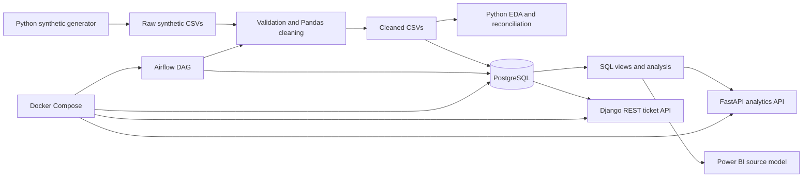

# Customer Support Performance and SLA Compliance Analytics System

A reproducible, synthetic-data portfolio project showing how a Business Analyst can translate customer-support questions into governed data, SQL metrics, APIs, orchestration, and Power BI-ready reporting assets.

> **Portfolio scope:** All records are fictional and contain no real personal information. The repository includes Power Query, DAX, SQL reconciliation, and dashboard build guides—not a `.pbix` file or a published dashboard.

## Business problem

Support leaders need a consistent way to understand demand, service speed, SLA risk, backlog, team workload, reassignments, reopened tickets, and customer satisfaction. Without shared metric definitions, one-to-many assignment records can inflate ticket counts, unresolved tickets can distort resolution averages, and missing surveys can be mistaken for poor ratings.

This project creates one documented analytical workflow that preserves metric grain, makes denominators explicit, and separates completed outcomes from current operational risk.

## Objectives

- Measure ticket volume by time, priority, category, channel, and current owner.
- Compare average and median first-response and resolution time using eligible tickets only.
- Report response and resolution SLA compliance with explicit eligible populations.
- Identify unresolved, overdue, high-priority, aging, and approaching-deadline tickets.
- Distinguish current team ownership from historical assignment activity.
- Analyze reassignment, reopening, and customer-satisfaction patterns without causal claims.
- Reconcile key reporting results independently in Python and SQL.
- Provide reusable API, Airflow, Docker, and Power BI source assets.

## Architecture



Airflow orchestrates availability checks, validation, cleaning, loading, and post-load checks. Docker Compose defines PostgreSQL, FastAPI, Django REST Framework, and practical Airflow services with service-name networking, health checks, and persistent volumes.

## Technology

| Layer | Technology |
| --- | --- |
| Data generation and preparation | Python 3.12, Pandas, NumPy |
| Analysis and charts | Pandas, NumPy, Matplotlib |
| Database and metrics | PostgreSQL, SQL |
| Analytics API | FastAPI, Pydantic, Psycopg |
| Ticket API | Django REST Framework, unmanaged shared-schema models |
| Orchestration | Apache Airflow DAG and reusable Python tasks |
| Deployment assets | Dockerfiles and Docker Compose |
| BI assets | Power Query M, DAX, dashboard specifications, validation SQL |
| Verification | `unittest`, data validators, SQL/Python reconciliation |

## Data

The tracked seed-42 dataset covers January through June 2026 with a fixed analysis snapshot of `2026-07-01T00:00:00Z`.

| Table | Grain | Rows |
| --- | --- | ---: |
| Customers | One synthetic customer | 2,500 |
| Teams | One support team | 3 |
| Agents | One synthetic agent | 30 |
| Tickets | One support ticket | 10,000 |
| Assignment history | One uninterrupted ownership interval | 14,035 |
| Customer feedback | Zero or one survey response per ticket | 3,758 |

The generator includes priorities, statuses, channels, categories, unresolved tickets, reassignments, reopened tickets, SLA breaches, and optional feedback. All patterns are designed project assumptions rather than evidence from a real organization. See the [data dictionary](docs/data_dictionary.md), [generation guide](docs/synthetic_data_guide.md), and [cleaning rules](docs/data_cleaning.md).

## KPI definitions

| KPI | Definition |
| --- | --- |
| Total tickets | Distinct ticket IDs in the selected filter context |
| Response time | `first_response_at - created_at`; unanswered tickets are excluded |
| Resolution time | Final `resolved_at - created_at`; unresolved tickets are excluded |
| Response SLA compliance | Response SLA met ÷ (met + breached); pending excluded |
| Resolution SLA compliance | Resolution SLA met ÷ (met + breached); pending excluded |
| Current backlog | Tickets with null final `resolved_at` at the fixed snapshot |
| Overdue backlog | Current backlog with breached resolution SLA |
| Reassigned tickets | Distinct tickets with at least one `Reassignment` event |
| Reopened rate | Distinct reopened tickets ÷ distinct tickets |
| Average CSAT | Mean rating among submitted feedback only; missing feedback is not zero |
| Feedback coverage | Rated tickets ÷ resolved tickets |

Illustrative elapsed-calendar-time SLA assumptions are Critical 15-minute response/4-hour resolution, High 1-hour/8-hour, Medium 4-hour/24-hour, and Low 8-hour/72-hour. An event exactly at its deadline is compliant. These targets are not universal standards. See [KPI definitions](docs/kpi_definitions.md) for complete boundaries and denominators.

## SQL analysis

The PostgreSQL layer contains six normalized business tables, an SLA-policy table, keys, checks, indexes, and reusable reporting views. Analysis queries cover ticket volume and mix, average and median service times, SLA breaches and eligible populations, current-owner team performance, backlog and aging, and satisfaction and feedback coverage.

Reporting views start from one row per ticket and pre-aggregate assignment history before joins, preventing duplicate ticket counts. Historical assignment views remain assignment-grain. See [PostgreSQL setup and queries](docs/postgres.md), [reporting views](docs/reporting_views.md), and the files in [`sql/`](sql/).

The independently calculated Python baseline expects 10,000 tickets, 1,136 unresolved tickets, 80.22% response SLA compliance, 53.72% resolution SLA compliance, 2.70/1.25 mean/median response hours, and 40.57/18.33 mean/median resolution hours. These are synthetic observations. A live SQL comparison requires a loaded PostgreSQL instance.

## Dashboard assets

The Power BI package contains Power Query transformations, a star-schema specification, role-playing team/agent/date dimensions, DAX measures, reconciliation SQL, and manual page-building guides for executive overview, SLA performance, team comparison, backlog aging, and customer satisfaction.

Ticket volume comes only from the ticket fact. Assignment history and feedback remain separate facts so joins do not multiply ticket counts. See the [Power BI overview](docs/power_bi.md) and model files in [`powerbi/`](powerbi/).

## APIs

Two separate read-only services share the PostgreSQL schema:

- **FastAPI** provides health/readiness, overview, SLA compliance, team performance, response-time, and paginated backlog analytics.
- **Django REST Framework** provides paginated ticket listing, ticket details, validated status/priority/team/date filters, and assignment history.

FastAPI owns aggregate analytics; Django REST Framework owns operational ticket retrieval. Django models are unmanaged, so Django migrations do not create or alter the shared analytics tables. See the consolidated [API guide](docs/api.md).

## Quick start

Requirements: Python 3.11 or newer. Python 3.12 is the delivered/tested runtime. PostgreSQL is required only for database-backed workflows; Docker and Power BI Desktop are optional for their respective stages.

```powershell
python -m venv .venv
.\.venv\Scripts\python.exe -m pip install -r requirements.txt
.\.venv\Scripts\python.exe -m scripts.validate_synthetic_data
.\.venv\Scripts\python.exe -m scripts.clean_data
.\.venv\Scripts\python.exe -m scripts.eda
.\.venv\Scripts\python.exe -m scripts.load_postgres --check-only
.\.venv\Scripts\python.exe -m unittest discover -s tests -v
```

Credentials belong in environment variables or a local secret manager. Copy `.env.example` only as a reference; the application does not automatically parse it. For complete local, database, API, and Docker instructions, see [setup](docs/setup.md).

## Pipeline and orchestration

The reproducible flow checks availability, validates source relationships, cleans and quarantines data, performs database preflight, loads PostgreSQL transactionally, validates post-load relationships, and reconciles SQL reporting with Python. The Airflow DAG reuses the same Python modules and defines retries, timeouts, logging, idempotent replacement, and post-load checks. See the consolidated [pipeline guide](docs/pipeline.md).

## Testing and validated scope

The latest documented local audit ran **90 tests: 90 passed, 0 failed, 0 skipped**. It also passed source-data validation, cleaning, EDA regeneration, PostgreSQL preflight, Django system checks, and Python compilation.

Live PostgreSQL execution, Docker builds, Airflow execution, and Power BI Desktop refresh were not available in that audit environment and are not presented as passed. See [testing](docs/testing.md) and the dated [end-to-end audit](docs/end_to_end_audit.md).

## Repository structure

```text
api/                 FastAPI analytics service
config/              Shared SLA policy
dags/                Airflow DAG
data/sample/         Reproducible synthetic source data
docker/              Service Dockerfiles and database initialization
docs/                Business, technical, setup, and validation documentation
orchestration/        Reusable Airflow task functions
powerbi/              Power Query and DAX source assets
reports/              Data-quality, EDA, and reconciliation outputs
scripts/              Generation, validation, cleaning, EDA, loading, reconciliation
sql/                  Schema, views, queries, and BI validation SQL
tests/                Automated regression tests
ticket_service/       Django REST Framework ticket service
compose.yaml          Local multi-service topology
```

## Limitations

- Synthetic results cannot establish real operational performance or business impact.
- Current-owner comparisons are descriptive and do not prove team or agent causation.
- The fixed snapshot provides reproducibility, not a live clock or historical backlog reconstruction.
- The APIs intentionally omit authentication and authorization and are unsuitable for public deployment as-is.
- Docker environment variables are convenient for local use, not a production secret-management design.
- No PBIX file, hosted dashboard, deployed API, or executed Airflow run is claimed.

See [limitations and responsible interpretation](docs/limitations.md) before presenting the project.

## Documentation

- [Final Business Analyst report](reports/final_business_analyst_report.md)
- [Interview presentation outline](docs/interview_presentation_outline.md)
- [Final completion checklist](docs/final_completion_checklist.md)
- [Setup](docs/setup.md)
- [Testing and validation](docs/testing.md)
- [APIs](docs/api.md)
- [Power BI](docs/power_bi.md)
- [Pipeline and orchestration](docs/pipeline.md)
- [Limitations](docs/limitations.md)
- [Business requirements](docs/business_requirements.md)
- [Data dictionary](docs/data_dictionary.md)
- [KPI definitions](docs/kpi_definitions.md)
- [PostgreSQL and SQL](docs/postgres.md)
- [End-to-end audit](docs/end_to_end_audit.md)

## Publication status

This repository has been prepared locally. It has not been published or pushed by this work. Publication requires explicit authorization and a final review of Git history, repository visibility, branch protections, and any generated artifacts intended for release.
