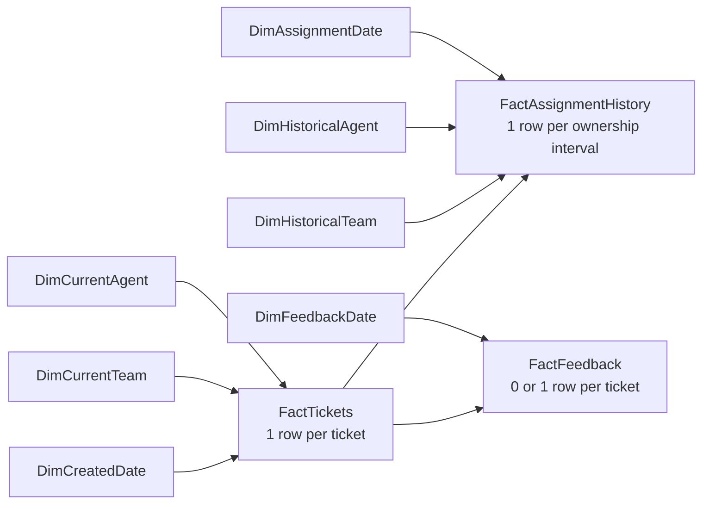

# Power BI Model and Power Query Guide

This guide builds an Import-mode Power BI model from the PostgreSQL `support_analytics` schema. The repository contains Power Query M source and DAX measure definitions; it does **not** contain a `.pbix` file.

## Model grain

| Model table | Grain | Key | Expected default rows |
| --- | --- | --- | ---: |
| `FactTickets` | One ticket at the fixed snapshot | `ticket_id` | 10,000 |
| `FactAssignmentHistory` | One uninterrupted ownership interval | `assignment_id` | 14,035 |
| `FactFeedback` | One optional survey response; at most one per ticket | `feedback_id`; `ticket_id` is unique | 3,758 |
| `DimCurrentTeam` | One support team used for current ticket ownership | `team_id` | 3 |
| `DimHistoricalTeam` | Role-playing copy used only for assignment history | `team_id` | 3 |
| `DimCurrentAgent` | One agent used for current ticket ownership | `agent_id` | 30 |
| `DimHistoricalAgent` | Role-playing copy used only for assignment history | `agent_id` | 30 |
| Date dimensions | One UTC calendar date | `Date` | 2026-01-01 through 2026-12-31 for the default data |

`FactTickets` is the ticket-count source. Never merge assignment history into tickets: one ticket can have multiple assignment rows. `FactAssignmentHistory` remains a separate fact table and uses `DISTINCTCOUNT(ticket_id)` when reporting historical assigned tickets. Feedback also remains separate; its missing row means no rating and must never become a zero score.

## Timezone and null semantics

Every source timestamp is UTC. PostgreSQL returns `TIMESTAMPTZ`; `fnUtcDateTime` first switches it to offset `+00:00`, then removes the timezone marker because the Power BI semantic model stores Date/Time values without an offset. Every transformed timestamp therefore means **UTC**, even though the model data type displays `Date/Time`.

Do not apply local-time conversion. The fixed snapshot is the `pAnalysisAsOfUtc` parameter, `2026-07-01 00:00:00 UTC`. Response and resolution durations use elapsed calendar hours. Null first response and final resolution timestamps remain null. Response/resolution averages and medians therefore exclude missing events automatically. Unresolved age is populated only for tickets with null final `resolved_at`; resolved tickets keep null unresolved age.

The date roles use UTC dates:

- `DimCreatedDate` filters ticket creation and is the main reporting date.
- `DimAssignmentDate` filters assignment starts.
- `DimFeedbackDate` filters survey submissions.

## Data types

| Fields | Power BI type | Null handling |
| --- | --- | --- |
| IDs, priority, category, channel, status, SLA status, assignment reason, labels | Text | Required source keys/categories stay non-null; missing feedback is represented by no fact row |
| Reopen count, SLA target minutes, CSAT score, date key, calendar numbers | Whole number | Required where a row exists |
| Response, resolution, unresolved-age, and recorded-interval hours | Decimal number | Response/resolution remain null when the ending event is missing; unresolved age remains null after final resolution |
| UTC event/deadline timestamps | Date/Time | Nullable lifecycle timestamps stay null; values represent UTC after offset removal |
| Created, assigned, submitted, and calendar dates | Date | Derived only from required event timestamps for that table |
| `is_unresolved`, `is_overdue`, `is_reopened`, `is_current_assignment`, `is_positive_csat` | True/False | Derived explicitly; never inferred from a blank numeric value |

`customer_id` remains a text key on tickets and feedback in this requested model. Add a customer dimension later only if segment/region reporting is required; do not merge customers into assignment history.

The dataset is a fixed end-state snapshot. `is_unresolved`, `is_overdue`, and unresolved age describe current backlog at `pAnalysisAsOfUtc`; they cannot reconstruct backlog on a historical date. Assignment intervals show historical ownership, not historical status or active handling effort.

## Relationships

Create these relationships manually after loading. Use the stated direction; do not enable automatic bidirectional relationships.

| One side | Many/optional side | Cardinality | Active | Filter direction |
| --- | --- | --- | --- | --- |
| `DimCreatedDate[Date]` | `FactTickets[created_date]` | 1:* | Yes | Date → Tickets |
| `DimCurrentTeam[team_id]` | `FactTickets[current_team_id]` | 1:* | Yes | Team → Tickets |
| `DimCurrentAgent[agent_id]` | `FactTickets[current_agent_id]` | 1:* | Yes | Agent → Tickets |
| `FactTickets[ticket_id]` | `FactAssignmentHistory[ticket_id]` | 1:* | Yes | Tickets → Assignment History |
| `DimHistoricalTeam[team_id]` | `FactAssignmentHistory[team_id]` | 1:* | Yes | Historical Team → Assignment History |
| `DimHistoricalAgent[agent_id]` | `FactAssignmentHistory[agent_id]` | 1:* | Yes | Historical Agent → Assignment History |
| `DimAssignmentDate[Date]` | `FactAssignmentHistory[assigned_date]` | 1:* | Yes | Date → Assignment History |
| `FactTickets[ticket_id]` | `FactFeedback[ticket_id]` | Configure as 1:*; actual data is 1:0/1 | Yes | Tickets → Feedback |
| `DimFeedbackDate[Date]` | `FactFeedback[submitted_date]` | 1:* | Yes | Date → Feedback |

Current Team/Agent filters describe the ticket owner at the snapshot. Historical Team/Agent filters describe assignment rows. A historical team slicer should be used with `Historical Assigned Tickets`, `Reassignment Events`, or other assignment-grain measures; it intentionally does not redefine current team ownership.

Configure the feedback relationship as 1:* even though the validated current data has at most one feedback row per ticket. This keeps filtering single-direction from tickets to feedback, preserves unresolved and unrated tickets in ticket denominators, and remains safe if a later project version permits multiple surveys. Do not connect `DimCurrentTeam` to `DimCurrentAgent[team_id]`; both dimensions independently filter tickets, which avoids a second model path.

Hide foreign keys, raw target-minute fields, and technical timestamps from report view when they are not needed by users. Keep them in the model for validation. Mark all three date-role tables as date tables using their `Date` columns. Sort `Month` by `MonthNumber`.

## Import steps in Power BI Desktop

1. Confirm PostgreSQL has been loaded with `python -m scripts.load_postgres`. Install the PostgreSQL provider requested by Power BI Desktop if the connector prompts for it.
2. Open Power BI Desktop and choose **Transform data → Power Query Editor**.
3. Create three parameters named `pServer` (Text), `pDatabase` (Text), and `pAnalysisAsOfUtc` (Date/Time/Timezone). Use the expressions in `powerbi/power_query/pServer.m`, `pDatabase.m`, and `pAnalysisAsOfUtc.m`. Change server/database values for your environment; keep credentials in Power BI's data-source settings.
4. Create blank queries in this order and paste each file's M expression into **Advanced Editor**: `StagingDatabase`, `fnUtcDateTime`, `FactTickets`, `FactAssignmentHistory`, `FactFeedback`, `DimTeams`, `DimAgents`, and `DimDate`.
5. Disable load for `StagingDatabase`, `fnUtcDateTime`, `DimTeams`, `DimAgents`, and `DimDate`. They are staging/function queries.
6. Create the role-playing reference queries by pasting the small expressions from `DimCurrentTeam.m`, `DimHistoricalTeam.m`, `DimCurrentAgent.m`, `DimHistoricalAgent.m`, `DimCreatedDate.m`, `DimAssignmentDate.m`, and `DimFeedbackDate.m`. Enable load for these seven dimensions and the three fact tables.
7. Confirm Power Query shows no errors and preserves nulls in `first_response_at`, `resolved_at`, `unassigned_at`, and missing feedback rows. Choose **Close & Apply**.
8. In Model view, delete relationships Power BI guessed automatically. Add only the relationships listed above. Confirm `ticket_id` is unique in `FactTickets`, feedback `ticket_id` has no duplicates, and dimension keys are unique.
9. Mark each date role as a date table. Set percentage measures to Percentage with two decimals, hour and CSAT measures to Decimal with two decimals, and counts to Whole number.
10. Create a small table named `Measures` using **Enter data**, then add measures from `powerbi/dax/measures.dax`. Hide its placeholder column.
11. Save the report locally under `powerbi/` only after validation. A `.pbix` is a binary artifact; review its embedded data before sharing.

## Validation checklist

Create temporary cards or a matrix and reconcile the following before designing visuals:

| Check | Expected default result |
| --- | ---: |
| `COUNTROWS(FactTickets)` | 10,000 |
| `DISTINCTCOUNT(FactTickets[ticket_id])` | 10,000 |
| `COUNTROWS(FactAssignmentHistory)` | 14,035 |
| `DISTINCTCOUNT(FactAssignmentHistory[ticket_id])` | 10,000 |
| `COUNTROWS(FactFeedback)` | 3,758 |
| Unresolved Tickets | 1,136 |
| Overdue Tickets | 1,082 |
| Reassignment Events | 3,104 |
| Reassigned Tickets | 2,617 |
| Reopened Tickets | 931 |
| Response SLA Compliance | 80.22% |
| Resolution SLA Compliance | 53.72% |
| Overall SLA Compliance | 44.06% |
| Average CSAT | 3.87 |

Then validate filter behavior:

1. Put `DimCurrentTeam[team_name]` beside `Ticket Count`; team counts must total 10,000.
2. Put `DimHistoricalTeam[team_name]` beside `Historical Assigned Tickets`; do not sum those distinct counts as a portfolio ticket total because a ticket may have moved between teams.
3. Put `DimCreatedDate[YearMonth]` beside `Ticket Count`; monthly counts must total 10,000.
4. Put `DimAssignmentDate[YearMonth]` beside `Reassignment Events`; this filters by handoff date without changing ticket creation-date semantics.
5. Confirm average response excludes the 204 unanswered tickets and average resolution excludes the 1,136 unresolved tickets.
6. Confirm `Feedback Responses` is 3,758 and missing feedback is absent, not scored as zero.
7. Select a ticket with multiple assignment rows. `Ticket Count` must remain 1 while assignment row count can exceed 1.

If any count differs, check relationship cardinality/direction, parameter values, source schema, refresh errors, and whether a fact table was merged into another query. The independent expected results are also recorded in `reports/reporting_reconciliation.json`.

## Measure denominators and filter context

The measures in `powerbi/dax/measures.dax` inherit the current report filter context: a priority, created-date, or current-team slicer narrows `FactTickets` before the measure is evaluated. `CALCULATE` adds the measure's condition (for example, `resolved_at` is not blank) while retaining compatible slicer filters. No measure removes filters with `ALL`, so totals respond naturally to report selections.

`Total Tickets` uses a distinct ticket count as a defensive ticket-grain denominator. `Open Tickets` uses the business statuses Open, In Progress, and Pending. `Unresolved Backlog` instead uses a null final resolution timestamp; the two currently reconcile but are deliberately separate definitions. Response averages and medians include only answered tickets. Resolution averages and medians explicitly include only tickets with a final `resolved_at`, so unresolved tickets cannot enter completed-resolution statistics.

First-response and resolution compliance divide Met by Met plus Breached. Pending tickets are excluded because their deadline outcome is not final at the snapshot. `DIVIDE` returns blank when the eligible denominator is zero. `SLA Breach Count` counts breached commitments, so one ticket can contribute two; `Tickets with Any SLA Breach` is the distinct-ticket alternative. Reopened tickets use the ticket-level reopen flag. Customer-rating measures evaluate only `FactFeedback`; absent feedback is no row and is never converted to zero. Positive CSAT uses ratings 4 or 5 divided by actual feedback responses.

Ticket-side filters flow to assignment history and feedback through the documented single-direction relationships. Feedback-date filters do not flow backward to tickets, and historical team filters affect assignment measures rather than current ticket measures. This is intentional: combining these roles in one visual requires choosing measures whose grain matches the slicer.

Run `sql/power_bi_reconciliation.sql` in PostgreSQL to compare the unfiltered headline cards with SQL. For sliced reconciliation, add the same predicate to the `support_analytics.tickets` CTE and, when reconciling feedback, filter feedback through the matching ticket IDs rather than joining assignment history. The query uses `NULLIF`, the SQL equivalent of a safe zero-denominator check, and keeps feedback and ticket calculations in separate CTEs to prevent row multiplication.
