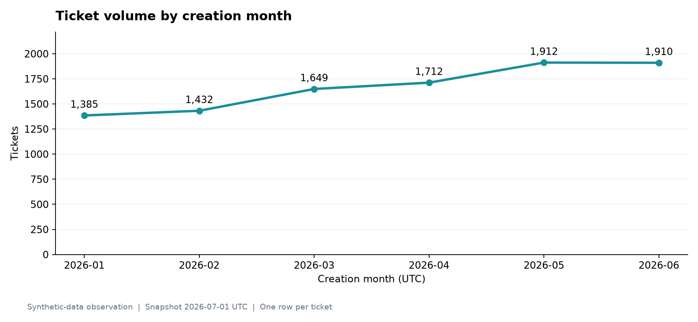
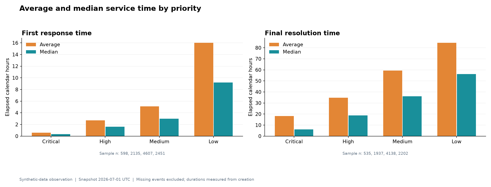
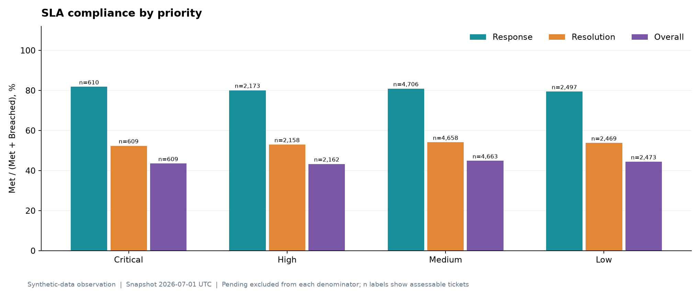
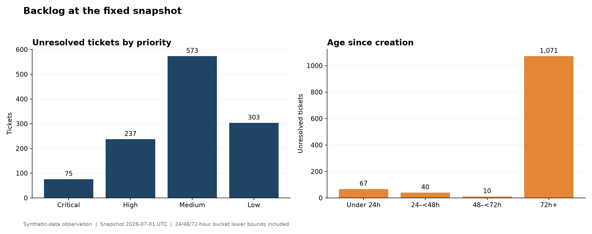
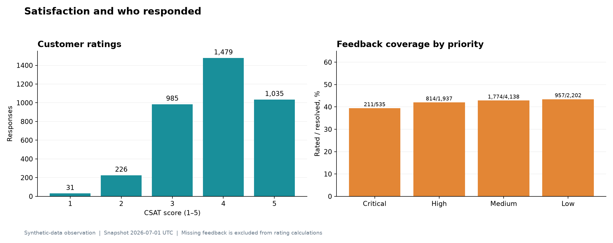

# Final Business Analyst Report

## Customer Support Performance and SLA Compliance Analytics System

**Reporting basis:** validated synthetic data  
**Ticket creation period:** 1 January–30 June 2026 UTC  
**Fixed analysis snapshot:** 1 July 2026 00:00 UTC  
**Purpose:** portfolio demonstration; not a report about a real organization

> **Synthetic-data notice:** Every customer, agent, ticket, assignment, feedback response, and result in this report is fictional. Findings demonstrate an analytical method and reflect generator assumptions. They must not be presented as observed client performance.

## 1. Executive summary

This project addresses a common support-operations problem: leaders need a trustworthy view of demand, service speed, SLA performance, backlog, ownership movement, reopening, and customer satisfaction, but those measures can be misleading when their grain and eligible populations are not controlled.

The validated dataset contains 10,000 tickets and 14,035 assignment intervals. All 30,326 source rows passed the documented quality rules, all foreign keys resolved, and no source row was silently removed. Ticket-level analysis preserves one row per ticket; assignment history remains a separate one-to-many fact.

Validated synthetic observations show rising simulated demand, stronger response compliance than resolution compliance, a heavily overdue snapshot backlog, a long tail in both response and resolution times, material reassignment and reopening populations, and incomplete feedback coverage. These patterns support investigation and workflow recommendations, not claims of real operational failure.

Key validated synthetic observations:

- 10,000 tickets were created across the six-month period; monthly volume rose from 1,385 in January to 1,910 in June.
- 9,796 tickets received a response. Mean response time was 2.70 hours and median response time was 1.25 hours.
- 8,864 tickets reached final resolution. Mean resolution time was 40.57 hours and median resolution time was 18.33 hours.
- Response SLA compliance was 80.22%; resolution SLA compliance was 53.72%; overall ticket-level SLA compliance was 44.06%.
- 1,136 tickets were unresolved at the snapshot; 1,082 were overdue and 1,056 were at least 72 hours old.
- 2,617 tickets had an ordinary reassignment, representing 3,104 reassignment events; 931 tickets reopened once.
- 3,758 resolved tickets had feedback. Average CSAT was 3.87/5, but feedback coverage was only 42.40%.

## 2. Business problem

Support managers need to answer five connected questions:

1. How much work is entering support, and what is its mix?
2. How quickly do customers receive a first response and final resolution?
3. Which commitments are being met, breached, or remain pending?
4. Which unresolved tickets require immediate attention?
5. How should ownership movement, reopening, and customer feedback inform operational review?

The analytical risk is not only missing data. It is also incorrect interpretation: counting assignment rows as tickets inflates demand; including unresolved tickets in completed resolution averages creates false values; treating missing feedback as zero understates satisfaction; and averaging percentages hides their denominators.

## 3. Objectives and stakeholder decisions

| Objective | Decision supported |
| --- | --- |
| Quantify volume and mix | Discuss staffing coverage and demand by month, priority, category, and channel |
| Measure response and resolution speed | Identify where elapsed time and long-tail cases need investigation |
| Measure SLA outcomes | Separate completed compliance from pending commitments and overdue work |
| Expose backlog age and priority | Prioritize queue review and escalation |
| Compare ownership views safely | Separate current-owner outcomes from historical assignment activity |
| Analyze reopening and reassignment | Identify populations for workflow and root-cause review |
| Report CSAT with coverage | Interpret respondent sentiment without treating missing surveys as zero |
| Reconcile tools | Maintain consistent Python, SQL, API, and Power BI definitions |

Primary stakeholders are the support manager, team leads, operations analyst, and business sponsor. The project does not support individual productivity ranking or causal performance conclusions.

## 4. Data scope and model

| Dataset | Grain | Validated rows |
| --- | --- | ---: |
| Customers | One fictional customer | 2,500 |
| Teams | One support team | 3 |
| Agents | One fictional agent | 30 |
| Tickets | One support ticket | 10,000 |
| Assignment history | One uninterrupted ownership interval | 14,035 |
| Customer feedback | Zero or one submitted response per ticket | 3,758 |
| **Total** |  | **30,326** |

The ticket table is the source for ticket volume and ticket outcomes. Assignment history is used for handoffs and historical ownership, not as a ticket-count source. Feedback is optional and is left joined so unrated tickets remain visible.

## 5. Data-quality assessment

The validation and cleaning workflow checked:

- required files, columns, types, and controlled categories;
- unique primary keys and valid identifier formats;
- UTC timestamps, snapshot bounds, and event ordering;
- ticket lifecycle, reopening, unresolved, and closed-state rules;
- customer, team, agent, ticket, assignment, and feedback foreign keys;
- contiguous assignment intervals and one current owner per ticket;
- SLA targets, deadlines, statuses, and exact-boundary behavior;
- feedback uniqueness, rating range, customer ownership, and submission chronology;
- persisted row counts and SHA-256 checksums against metadata.

| Quality result | Value |
| --- | ---: |
| Input rows | 30,326 |
| Accepted rows | 30,326 |
| Rejected/quarantined rows | 0 |
| Normalization changes | 0 |
| Unresolved tickets retaining legitimate null resolution | 1,136 |
| Source row-count manifest | Matched |
| Source checksum manifest | Matched |
| Ready for analysis | Yes |

Zero rejected rows are expected because the tracked source was generated to satisfy the rules. The cleaner's negative tests separately confirm that malformed, duplicate, contradictory, and orphaned records are quarantined rather than silently discarded.

## 6. KPI definitions and governance

All ticket measures use accepted distinct tickets in the active creation-date and dimension filters. Percentages are calculated from component counts, never averaged across groups. Display rounding occurs only after full-precision calculation.

| KPI | Definition | Eligible population |
| --- | --- | --- |
| Ticket volume | Distinct ticket count | All accepted tickets in context |
| Response hours | `first_response_at - created_at` | Answered tickets only |
| Resolution hours | Final `resolved_at - created_at` | Finally resolved tickets only |
| Response SLA compliance | Met ÷ (Met + Breached) | Assessable response commitments |
| Resolution SLA compliance | Met ÷ (Met + Breached) | Assessable resolution commitments |
| Overall SLA compliance | Overall Met ÷ (Met + Breached) | Assessable ticket-level overall statuses |
| Current backlog | Null final `resolved_at` | Tickets unresolved at the fixed snapshot |
| Overdue backlog | Current backlog with breached resolution SLA | Unresolved tickets past deadline |
| Reassigned tickets | Distinct tickets with an ordinary `Reassignment` row | All tickets in context |
| Reopened tickets | Tickets with `reopen_count = 1` | All tickets in context |
| Average CSAT | Mean non-null score | Rated tickets only |
| Positive CSAT | Ratings 4–5 ÷ rated tickets | Rated tickets only |
| Feedback coverage | Rated resolved tickets ÷ resolved tickets | Finally resolved tickets |

Illustrative calendar-time SLA assumptions are:

| Priority | Response target | Resolution target |
| --- | ---: | ---: |
| Critical | 15 minutes | 4 hours |
| High | 1 hour | 8 hours |
| Medium | 4 hours | 24 hours |
| Low | 8 hours | 72 hours |

An event at the exact deadline is Met. A missing event at the exact deadline remains Pending and becomes Breached only after the deadline. These targets are project assumptions, not universal standards.

## 7. SQL analysis and reporting design

The PostgreSQL design contains customer, team, agent, ticket, assignment-history, feedback, and SLA-policy tables with primary keys, foreign keys, checks, suitable timestamp/numeric types, and reporting indexes. Cleaned files load in dependency order inside one transaction.

SQL assets address:

- ticket volume by time and business dimensions;
- average and median response/resolution time;
- response, resolution, and overall SLA populations;
- current-owner team summaries;
- current backlog and age;
- reassignment and reopening rates;
- satisfaction, positive ratings, and feedback coverage;
- overdue ticket details and historical assignment activity.

The main reporting view has exactly one row per ticket. Assignment history is pre-aggregated before joining, preventing one-to-many multiplication. Current team means snapshot owner; historical team means the owner of an assignment interval.

Independent Python results match the expected SQL metric definitions and field mapping. A live PostgreSQL server was not available during the documented audit, so the repository does **not** claim observed execution of the SQL reconciliation. The live acceptance command must produce `database_compared: true` and `database_match: true` before SQL execution is presented as verified.

## 8. Dashboard design

The Power BI supporting assets define a three-fact model:

- `FactTickets`: one row per ticket and the only source for ticket counts;
- `FactAssignmentHistory`: one row per ownership interval;
- `FactFeedback`: one row per submitted survey.

Role-playing dimensions separate current from historical teams and agents. Relationships are single-direction to avoid ambiguous paths and duplicated counts.

Planned pages:

1. **Executive overview:** total tickets, backlog, SLA compliance, response time, resolution time, rating, demand trends, mix, team comparison, and slicers.
2. **SLA performance:** completed compliance, breach populations, trends, priority/team comparison, overdue unresolved tickets, and approaching deadlines.
3. **Team comparison:** current-owner ticket outcomes and a visually separate historical-assignment section with sample sizes.
4. **Backlog and satisfaction:** aging buckets, overdue/high-priority backlog, rating distribution, feedback coverage, and satisfaction by business dimensions.

Power Query, DAX measures, relationship guidance, visual mappings, and SQL validation queries are present. No PBIX file or executed dashboard is claimed.

## 9. Validated synthetic-data findings

### 9.1 Demand and mix

Monthly arrivals increased from 1,385 in January to 1,910 in June, a 37.91% change. This rise is an intended generator pattern. Technical was the largest category with 3,507 tickets; Email was the largest channel with 3,998 tickets. Medium was the largest priority with 4,701 tickets.

### 9.2 Service speed

Among 9,796 answered tickets, mean response time was 2.70 hours and median was 1.25 hours. Among 8,864 finally resolved tickets, mean resolution time was 40.57 hours and median was 18.33 hours. In both cases the mean exceeds the median, consistent with the simulated long tail. There were 204 unanswered and 1,136 unresolved tickets, which remain visible rather than being assigned artificial duration values.

### 9.3 SLA outcomes

| Commitment | Met | Breached | Pending | Assessable | Compliance |
| --- | ---: | ---: | ---: | ---: | ---: |
| Response | 8,013 | 1,976 | 11 | 9,989 | 80.22% |
| Resolution | 5,343 | 4,603 | 54 | 9,946 | 53.72% |
| Overall | 4,387 | 5,569 | 44 | 9,956 | 44.06% |

Response compliance exceeds resolution compliance by 26.50 percentage points. This identifies simulated resolution flow and aging as a larger investigation area than initial response; it does not prove the cause.

### 9.4 Backlog

At the fixed snapshot, 1,136 tickets were unresolved, representing 11.36% of all tickets. Of those, 1,082 were overdue (95.25%) and 1,056 were at least 72 hours old. Medium priority formed the largest backlog with 543 tickets. Average unresolved age was 1,874.71 hours and median age was 1,741.00 hours.

This is a current snapshot of the selected creation cohort. The available records cannot reconstruct daily historical backlog.

### 9.5 Reassignments and reopening

There were 2,617 tickets with at least one ordinary reassignment, equal to 26.17% of tickets, and 3,104 ordinary reassignment events. There were 931 reopened tickets (9.31%); 128 reopened tickets remained unresolved. These populations are suitable for root-cause review, but assignment ownership does not measure active effort.

### 9.6 Customer satisfaction

Among 3,758 rated resolved tickets, average CSAT was 3.87/5, median CSAT was 4.00/5, and 66.92% of ratings were 4 or 5. Feedback coverage was only 42.40% of resolved tickets, leaving 5,106 resolved tickets without feedback. Therefore, the rating should always be shown with its response count and coverage.

## 10. Operational recommendations

These are portfolio recommendations prompted by simulated results. A real organization should validate the same patterns using live data, staffing, workflow, and customer context before acting.

| Priority | Recommendation | Rationale from validated synthetic data | Suggested monitoring |
| --- | --- | --- | --- |
| Immediate | Establish an overdue-backlog triage queue, ordered by priority, deadline, and age | 1,082 of 1,136 unresolved tickets are overdue; 1,056 are 72h+ old | Overdue count, age buckets, oldest tickets, weekly clearance rate |
| Immediate | Separate response and resolution management routines | Response compliance is 80.22%, while resolution compliance is 53.72% | Met/breached/pending counts for both commitments |
| Near term | Review the simulated resolution workflow by priority/category/channel | Resolution mean and median are materially separated and resolution breaches total 4,603 | Median plus tail percentiles, eligible sample, breach reasons |
| Near term | Review tickets with reassignments and reopening as investigation cohorts | 2,617 reassigned tickets and 931 reopened tickets provide meaningful samples | Distinct tickets, events per ticket, reopened unresolved count |
| Near term | Add reason codes for breach, reassignment, reopening, and pending status | Current records show outcomes and ownership but not root cause | Completeness and distribution of reason codes |
| Near term | Improve survey instrumentation and report coverage beside CSAT | Only 42.40% of resolved tickets have feedback | Invitations, responses, coverage by channel/category/team |
| Planning | Compare demand with staffing schedules and skill coverage | Simulated monthly demand rises and Technical is the largest category | Tickets per staffed hour, schedule coverage, skill queues |
| Governance | Maintain a KPI dictionary and automated cross-tool reconciliation | Metric grain and denominators are easy to misapply | Reconciliation status, freshness, failed quality rules |

Do not use the current-team results to rank individual agents or claim that a team caused a breach. A real root-cause assessment would require ticket complexity, staffing, work logs, status transitions, and capacity data.

## 11. Limitations

- The dataset and all findings are synthetic and shaped by generator assumptions.
- SLA targets are illustrative elapsed-calendar-time rules, not contracts or industry standards.
- The fixed snapshot is reproducible but not live and does not support historical backlog reconstruction.
- Only one reopening cycle is modeled; resolution uses the final resolution timestamp.
- Assignment intervals represent ownership, not active handling time.
- Current ownership cannot attribute the full lifecycle outcome to the current team or agent.
- Feedback is optional and may be subject to response-selection bias.
- No staffing, cost, capacity, work-log, breach-reason, or survey-invitation data is available.
- Live PostgreSQL execution and SQL-to-Python database reconciliation were not run in the documented environment.
- API tests used controlled test doubles rather than a live PostgreSQL service.
- Docker and Airflow were validated statically but not executed.
- Power BI supporting assets were validated statically; no PBIX or Desktop refresh exists.
- The portfolio APIs omit production authentication, authorization, monitoring, and rate limiting.

## 12. Future improvements

1. Run the schema, loader, reporting views, and reconciliation against PostgreSQL and retain observed evidence.
2. Build and refresh the PBIX model, reconcile each page to SQL, and capture validation screenshots.
3. Run the Compose stack and a complete Airflow DAG execution with health and task-log evidence.
4. Add complete ticket status-event history to support historical backlog and time-in-status analysis.
5. Add staffing schedules, skills, capacity, holidays, and business-hour calendars.
6. Add structured reason codes for SLA breach, pending, reassignment, reopening, and closure.
7. Track survey invitations separately from responses to measure true response rates.
8. Support multiple reopen cycles while retaining event-level resolution history.
9. Add authentication, least-privilege roles, HTTPS, observability, and rate limiting before deployment.
10. After real data is available, establish targets with stakeholders and assess trends without overstating causality.

## 13. Validation statement

The local audit ran 90 automated tests: 90 passed, 0 failed, and 0 skipped. Source validation, cleaning, EDA regeneration, PostgreSQL file preflight, Django system checks, and Python compilation passed. External-runtime items not executed are explicitly listed above and must not be described as passed.

Supporting evidence:

- [Data-quality report](data_quality_report.md)
- [Detailed EDA](eda/eda_report.md)
- [KPI baseline](eda/kpi_summary.json)
- [Reporting reconciliation](reporting_reconciliation.json)
- [End-to-end audit](../docs/end_to_end_audit.md)
- [KPI definitions](../docs/kpi_definitions.md)

## 14. Conclusion

The project demonstrates an end-to-end Business Analyst workflow: define the business problem, govern metric definitions, validate relational data, analyze outcomes, design duplicate-safe SQL reporting, specify decision-focused dashboards, expose consistent read-only APIs, and document operational caveats. The most important analytical discipline is not a single tool—it is preserving grain, denominators, eligibility, time semantics, and evidence across every layer.
